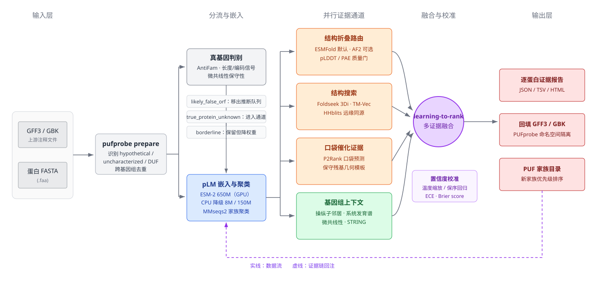

# PUFprobe

PUFprobe is a second-stage functional inference layer for bacterial genomes
annotated with [Bakta](https://github.com/oschwengers/bakta),
[Prokka](https://github.com/tseemann/prokka) or NCBI PGAP. These pipelines
leave between roughly 10% and 50% of the coding sequences labelled as
`hypothetical protein`, `uncharacterized protein` or domains of unknown
function. PUFprobe takes those records and combines protein language model
embeddings, predicted structures and structure searches, ligand-binding
pocket evidence and genomic-context signals into calibrated, auditable
functional predictions, while moving likely false ORFs out of the queue and
ranking genuinely unanchored families for wet-lab follow-up.

The design follows a detect-warn-skip policy: every heavy dependency
(ESM-2, ESMFold, MMseqs2, Foldseek, HH-suite) is optional. The full pipeline
runs on a laptop CPU with lightweight sequence features, and each model or
external tool adds one more evidence channel when it is available.



## Installation

The core package only needs Python 3.9 or newer.

```bash
git clone https://github.com/LLQ95/PUFprobe.git
cd PUFprobe
pip install -e .
```

Install the optional machine-learning dependencies for ESM-2 embeddings and
ESMFold structure prediction (a CUDA GPU is recommended):

```bash
pip install -e ".[ml]"        # torch + scikit-learn
pip install -e ".[cluster]"   # igraph + leidenalg clustering fallback
pip install -e ".[full]"      # everything
```

External binaries such as MMseqs2 and Foldseek are installed separately; see
[docs/server_setup.md](docs/server_setup.md) for a copy-pasteable Linux
server setup, including database downloads. Run `pufprobe doctor` to list
what is available in the current environment.

## Quick start

PUFprobe reads the GFF3/GBK and protein FASTA produced by your annotation
pipeline and writes all intermediate and final files into one working
directory. The eight subcommands are run in order:

```bash
pufprobe --workdir work prepare --input annotations/
pufprobe --workdir work embed
pufprobe --workdir work fold
pufprobe --workdir work search --dbdir databases/
pufprobe --workdir work context
pufprobe --workdir work rank
pufprobe --workdir work report
pufprobe --workdir work annotate
```

On a machine without GPUs or external tools, the same flow runs with the CPU
fallback:

```bash
pufprobe --cpu --workdir work prepare --input examples/demo_genome
pufprobe --cpu --workdir work embed --fallback-only
pufprobe --cpu --workdir work fold
pufprobe --cpu --workdir work search
pufprobe --cpu --workdir work context
pufprobe --cpu --workdir work rank
pufprobe --cpu --workdir work report
pufprobe --cpu --workdir work annotate
```

Every command resumes from a completion marker; add `--force` to rerun a
stage.

## Subcommands

`prepare` parses Bakta/Prokka GFF3, GenBank and `.faa` files, aligns the
protein sequences to the CDS records and runs the true-gene quality control.
Records that look like false ORFs (very short, low-complexity, anomalous
overlap or extreme composition) are flagged with an interpretable score and
moved out of the inference queue. `--include-smorf` keeps sub-30 aa
candidates through a permissive small-protein path.

`embed` computes one vector per candidate. It uses ESM-2 when torch and the
model weights are available, loads vectors from `--precomputed` otherwise, or
falls back to pure-Python sequence features with `--fallback-only`. It then
clusters the candidates into families (MMseqs2 when installed, an embedding
graph fallback otherwise) and selects one representative per family.

`fold` predicts structures for the family representatives only. ESMFold is
used when available; structures can also be supplied from `--precomputed`. A
pLDDT quality gate marks low-confidence models so that structure-based
channels do not over-interpret them.

`search` runs MMseqs2, Foldseek, HHblits, eggNOG and the pLM nearest-neighbour
channel by default (TM-Vec optional), against versioned databases under
`--dbdir`, and normalizes every hit into a unified evidence record. Missing
tools or databases disable one channel without stopping the run.

`context` computes operon and gene-neighbour coupling, phylogenetic profiles
across samples and cross-strain micro-synteny in pure Python. When CARD or
VFDB references are supplied with `--card` or `--vfdb`, candidates coupled
to resistance or virulence genes are flagged.

`rank` fuses the evidence channels. The default configuration loads a
whitened four-channel learning-to-rank model through `rank.ltr_model_path`; a
model passed with `--weights`, an empty path or an unloadable default falls
back to the transparent rule weights from the configuration. Confidence
scores are calibrated, high confidence requires agreement between two
independent evidence groups, and unanchored families receive a wet-lab
priority score.

`report` writes a machine-readable JSON dump together with auditable
HTML/Markdown reports that list every channel behind each prediction.

`annotate` backfills the high-confidence predictions into new GFF3, GBK and
renamed FASTA files under the working directory. The original annotation
files are never modified.

## Outputs

The working directory contains one numbered folder per stage, along with run
metadata and logs:

```text
work/
├── metadata.json
├── logs/pufprobe.log
├── 00_prepare/   samples.json, cds_records.json
├── 01_qc/        qc_summary.json
├── 02_embed/     embeddings.npz, manifest.json
├── 03_cluster/    families.json, clusters.tsv, representatives.faa
├── 04_fold/       structures/, fold_quality.tsv
├── 05_search/     *_raw.tsv, search_evidence.json
├── 06_context/    neighbours.tsv, phyloprofiles.tsv, context_evidence.json
├── 07_rank/       predictions.json, calibration.json, priorities.tsv
├── 08_report/     evidence.json, report.html, report.md
└── 09_annotate/   *.pufprobe.gff3, *.pufprobe.faa, changes.tsv
```

Each prediction in the reports carries the supporting channel, target
identifier, raw and calibrated scores, so that every assigned function can be
traced back to its evidence.

## Try the bundled example

A small synthetic two-genome dataset is included under
[examples/demo_genome](examples/demo_genome):

```bash
pufprobe --cpu --workdir _demo prepare --input examples/demo_genome
pufprobe --cpu --workdir _demo embed --fallback-only
pufprobe --cpu --workdir _demo context
pufprobe --cpu --workdir _demo rank
pufprobe --cpu --workdir _demo report
```

## Tests

```bash
pip install -e ".[test]"
pytest
```

The test suite contains unit tests for every stage and an end-to-end smoke
test that runs the complete CPU fallback pipeline on the bundled examples,
without any external binaries or GPUs.

## Server deployment

For running PUFprobe on a Linux HPC node (Bakta/Prokka in existing conda
environments, MMseqs2/Foldseek/HH-suite databases, GPU or CPU), the
`server/` directory provides an idempotent, resumable script bundle and a
Chinese step-by-step runbook:

- `server/README_runbook.md` — full walkthrough from code sync to full run
- `server/configs/server_config.yaml` — paths, threads, mirrors, database tiers
- `00_setup_env.sh` → `01_download_dbs.sh` → `02_annotate.sh` →
  `03_run_pufprobe.sh` → `04_summary.sh`

## License

PUFprobe is released under the MIT License. See [LICENSE](LICENSE).
